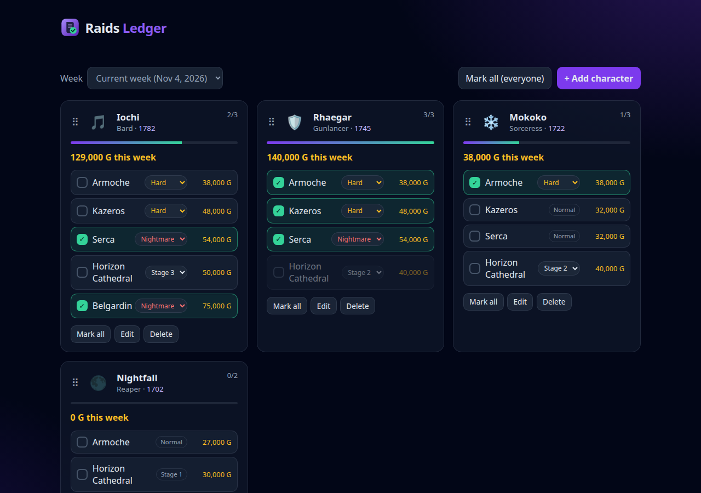
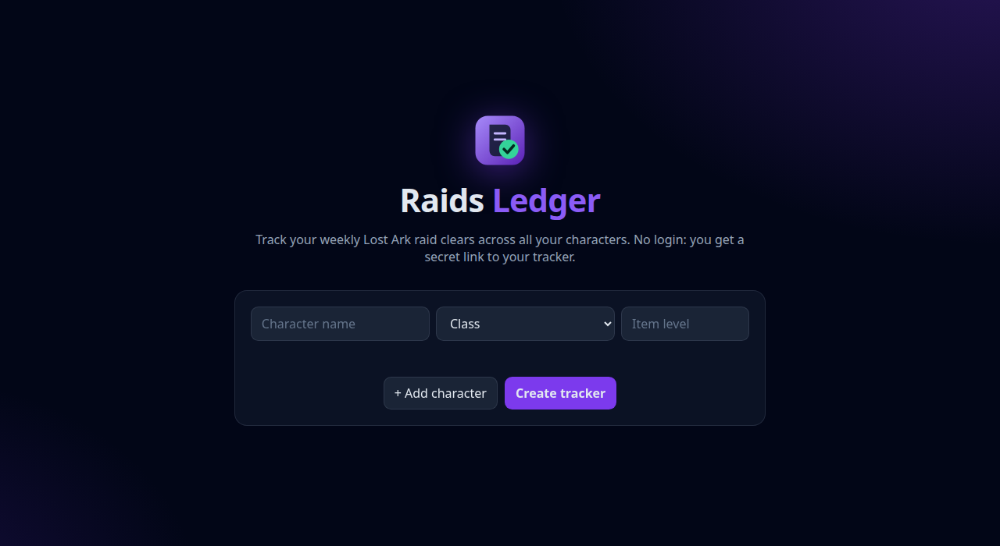

<div align="center">


# Raids Ledger

**Weekly Lost Ark raid tracker for all your characters.**
Tick clears, see your gold, never lose track of the week. No login, just a secret link.




</div>

## Features

- **Secret-link trackers.** No accounts: you get a private `/t/<token>` link. Share it to share the tracker.
- **Manual roster.** Add characters by name, class (picked from the full class list) and item level.
- **Eligible raids per character.** Armoche, Kazeros, Serca, Horizon Cathedral and Belgardin, filtered by ilvl.
- **Difficulty choice.** Defaults to the highest eligible difficulty, and you can drop to a lower one (for example Serca Hard instead of Nightmare).
- **One-click clears** with optimistic updates, plus **Mark all** per character or for everyone.
- **3-raid weekly limit.** Only 3 raids per character earn gold, so the UI stops you at 3. Mark all fills the highest-paying slots.
- **Gold tracking.** Gold per raid and the weekly total per character.
- **Weekly reset with history.** Clears reset every Wednesday and past weeks stay browsable.
- **Drag to reorder** characters, with class icons and a dark, Lost Ark Nexus-inspired look.

<div align="center">

</div>

## Why manual entry?

The official Lost Ark Open API only returns data for the Korean service (EU characters return `[]`), so the roster is entered by hand. Details and the test that proved it are in [`docs/lost-ark-api-region-findings.md`](docs/lost-ark-api-region-findings.md).

## Quick start

```sh
npm install
npm run db:local   # apply D1 migrations to the local database
npm run dev        # http://localhost:8787
npm test           # API and unit tests (Vitest)
npm run typecheck
```

## Configuration

| Setting | Where | Default |
|---|---|---|
| Weekly reset hour (Wednesday, UTC) | `RESET_HOUR_UTC` in `wrangler.jsonc` | `10` |
| Raid ilvl requirements and gold | `RAIDS` in `src/raids.ts` | current Tier 4 raids |
| Class list | `src/classes.ts` | all classes |

Raid data comes from Maxroll, Smilegate/Inven and lostmokokos.com. Check it against the game after patches.

### Class icons (optional)

Drop `<Class>.png` files (for example `Bard.png`) into `public/icons/`. Missing icons fall back to an emoji. The icons are Smilegate artwork, so they are git-ignored and not part of this repository.

## Deploy

```sh
npx wrangler d1 create raids-ledger   # copy the database_id (a UUID) into wrangler.jsonc
npm run db:remote                     # apply migrations to the remote database
npm run deploy
```

No secrets are required.

## How it works

- **Stack:** TypeScript, Cloudflare Workers with Hono, D1 (SQLite). The front end is plain HTML, CSS and ES modules served as static assets.
- **Secret links:** the token is 256 random bits and only its SHA-256 hash is stored. Anyone with the link can view and edit the tracker, and a lost link cannot be recovered.
- **Weekly reset:** the week is derived from the request time (latest Wednesday at the reset hour), so no cron job is needed. Clears are stored per week, which gives history for free.
- **Specs:** requirements live in [`openspec/specs`](openspec/specs).

## Project layout

```
src/          Worker API (index, raids, classes, validation, week, token)
public/       Static front end (landing, tracker, styles, logo)
migrations/   D1 schema migrations
test/         Vitest API and unit tests
docs/         Findings and README images
openspec/     Specs and archived change
```

<sub>Lost Ark is a trademark of Smilegate RPG and Amazon Games. This is an unofficial fan project.</sub>
